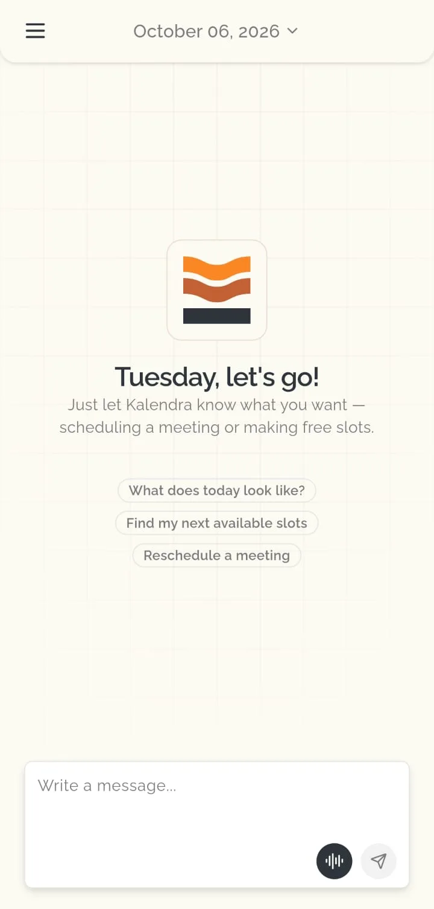
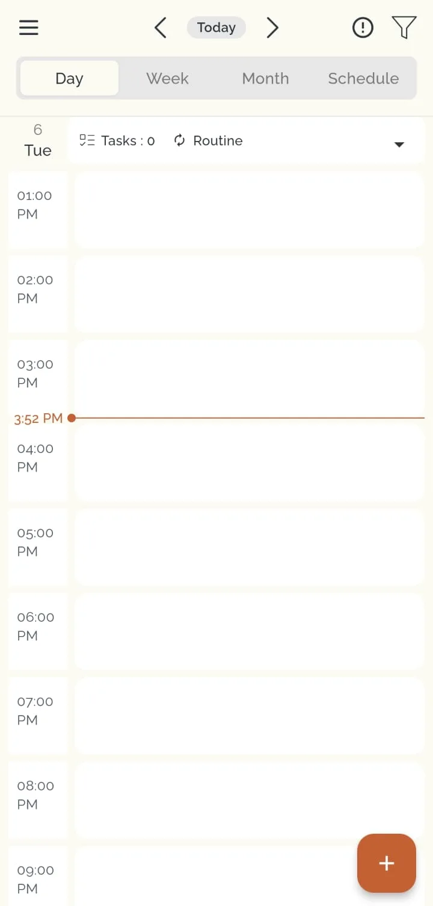
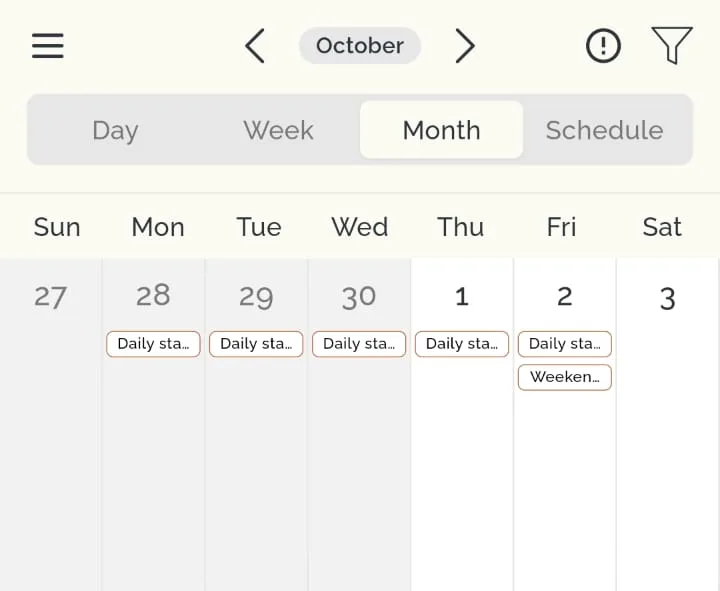
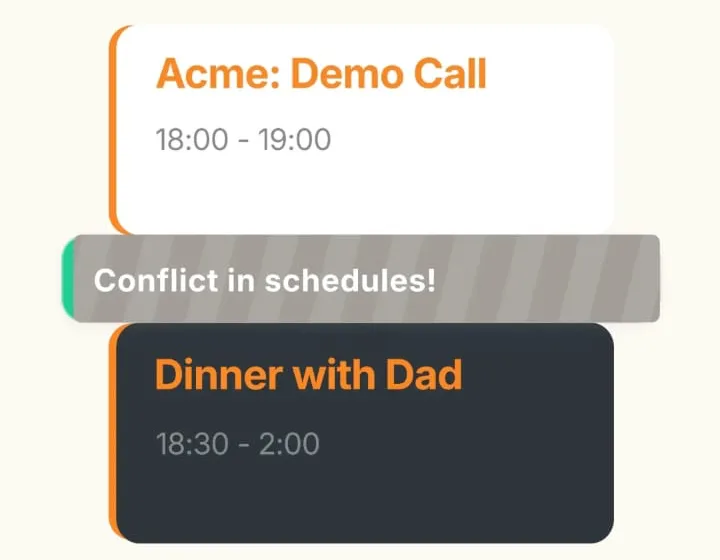
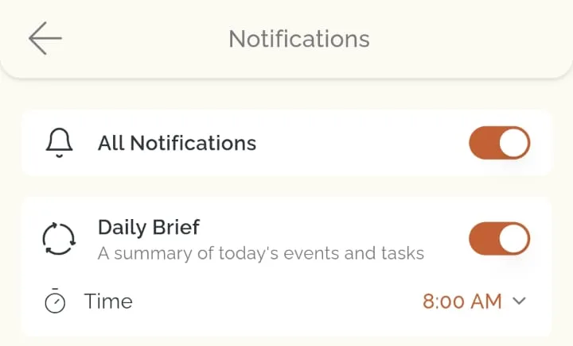
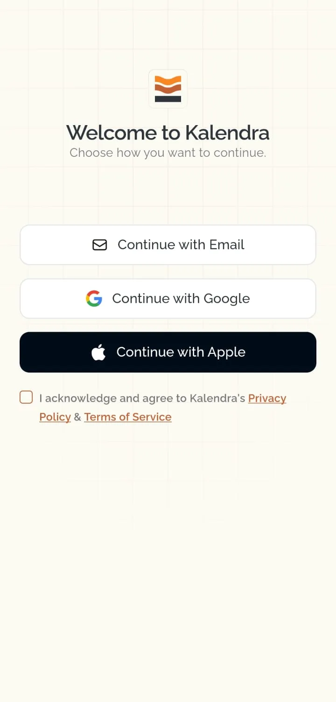
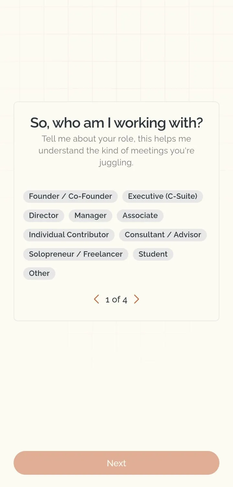
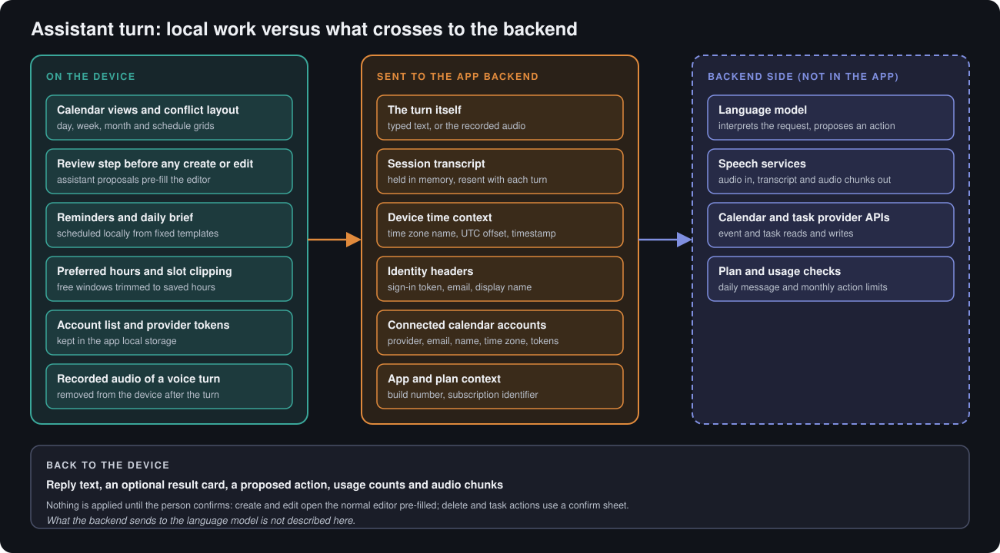
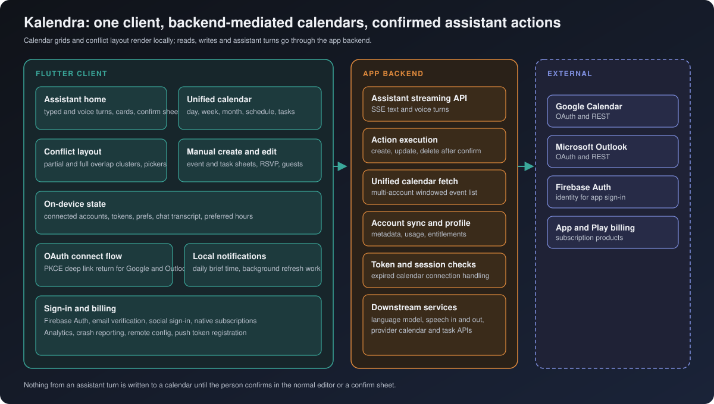
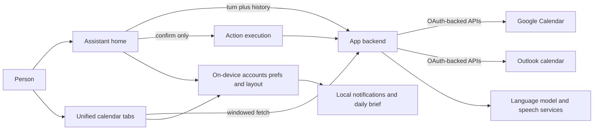

# Kalendra AI

**A cross-platform calendar assistant: connect Google or Outlook calendars, browse a unified day/week/month/schedule view with overlap-aware layout, and talk to an in-app assistant that proposes scheduling actions you confirm before anything is written.**

**Android · iOS** 
Flutter · Dart · HTTPS app backend · Firebase Auth · OAuth calendar connect

<table>
  <tr>
    <td></td>
    <td></td>
  </tr>
</table>
Real screenshots from the app, cropped to the app content (system status bar removed), captured with sample data, metadata removed.

---

## Get the App

  
  

## Product at a Glance

| | |
|---|---|
| **What it is** | A calendar client plus conversational assistant for viewing, creating and adjusting events and tasks across connected accounts |
| **Calendars** | Google and Microsoft Outlook connected through OAuth; multiple accounts shown in one unified grid |
| **Assistant** | Typed or voice turns streamed from the app backend; replies can include summary cards and a proposed action that still needs confirmation |
| **Views** | Day, week, month and schedule tabs; task counts on the day header; manual event and task sheets |
| **Conflicts** | Partial and full time overlaps get distinct colours, badges, side-by-side day columns and a picker sheet |
| **Preferences** | Preferred and off-hours windows clip availability suggestions; per-calendar colour and display name |
| **Notifications** | Local daily brief at a chosen time; toggles for all notifications and the brief |
| **Accounts** | Email/password with verification, Google sign-in, Apple sign-in; calendar reconnect when provider tokens expire |
| **Monetisation** | Native subscriptions with plan-gated assistant usage |
| **Code size** | About 47k lines of Dart across 164 files under the app library tree, and 13 test files |

## Product Showcase

<table>
  <tr>
    <td align="center"> <b>Month view</b> Multi-day event chips</td>
    <td align="center"> <b>Overlap artwork</b> Full versus partial styling</td>
    <td align="center"> <b>Notifications</b> Daily brief time</td>
    <td align="center"> <b>Sign-in</b> Email and social options</td>
  </tr>
  <tr>
    <td align="center"> <b>Onboarding</b> Role selection step</td>
    <td align="center"> <b>Splash</b> Branded launch screen</td>
  </tr>
</table>

The overlap image is product artwork illustrating conflict styling, not a live calendar capture. Onboarding marketing lines on other screens are not treated as engineering claims here.

## What the Assistant Does and Does Not Do

Kalendra is a **scheduling helper**, not a general-purpose autonomous agent.

- The assistant **interprets** natural-language requests and can **propose** creates, updates, deletes and task changes.
- **Creates and edits** open the same manual event editor the calendar already uses, pre-filled from the proposal; the person edits and saves.
- **Deletes and some task actions** use an explicit confirm sheet before the backend executes them.
- **Calendar reads** for both the grids and the assistant go through the app backend using the connected accounts the device holds.
- This portfolio makes **no claim** about how often proposals match what the person intended; confirmation is the intended control.

  

## Engineering Highlights

### Unified calendar without putting provider secrets in the UI layer
- **Problem:** Several Google and Outlook accounts must appear in one timeline, with tokens that expire at different times, while keeping OAuth complexity out of every screen.
- **Approach:** Connected accounts live in structured local storage with refresh handled centrally before network calls. The calendar home screen asks the backend for a single merged event list across accounts for a sliding month window, then maps rows into a shared event model for all tabs. Manual sheets and the assistant reuse the same account list.
- **Outcome:** One code path paints day, week, month and schedule views; empty-state and error copy distinguish "no accounts" from fetch failures.

### Overlap layout that distinguishes partial and full conflicts
- **Problem:** Stacked meetings are common; treating every overlap the same hides whether two events share identical start/end times or only intersect partway.
- **Approach:** Events on a day are grouped into conflict clusters. Partial overlaps use orange tinting, warning badges and "N+" entry points; exact same-slot overlaps use red styling, dashed dividers between side-by-side cards in day view, and different copy in the overlap picker sheet. Event detail sheets receive sibling lists so banners can say "Scheduling Conflict" versus partial overlap.
- **Outcome:** Dedicated widget tests cover conflict grid layout, day-view overlap rendering and the confirm sheet used before destructive assistant actions.

### Assistant turns with a hard confirmation boundary
- **Problem:** A language model can suggest calendar mutations, but automatic writes would be hard to undo and hard to explain in a consumer app.
- **Approach:** Each turn is streamed over server-sent events. The client keeps conversation history in memory and resends it with the next turn. When the backend returns a pending action map, the UI routes by action type: create/update pre-fill editors; delete shows confirmation; execution calls a separate backend execute path with a confirmed flag. Voice turns upload recorded audio for the same pipeline, then delete the local recording.
- **Outcome:** Chat cards can show availability or created-meeting summaries while calendar truth still changes only through confirmed paths.

### Account metadata sync separate from event cache
- **Problem:** Display names, colours, time zones and scheduling preferences must stay aligned across devices and with the backend profile, without making the calendar grid depend on a continuous sync engine on the phone.
- **Approach:** Local account records post to the backend when customisation changes; scheduling preference screens can pull fresh account rows back down. Event lists are fetched on demand when the visible month anchor moves or after a successful mutation refresh. Token refresh runs eagerly before reads so expired access tokens are renewed when the provider still allows it; dead refresh tokens surface a reconnect flow instead of silent failure.
- **Outcome:** The grid stays a pull-based view; account state is the durable cross-session layer the assistant headers include on every turn.

More detail: [docs/ENGINEERING_CHALLENGES.md](docs/ENGINEERING_CHALLENGES.md).

## Architecture

  

Details: [docs/ARCHITECTURE.md](docs/ARCHITECTURE.md).

## Technology Stack

| Layer | Technology |
|---|---|
| App | Flutter / Dart 3, custom design system, generated localisation |
| Calendar UI | Day/week/month/schedule tabs, conflict cluster layout, task checklist on schedule |
| Assistant | Streaming HTTP client, in-memory transcript, optional streamed reply audio, on-device text-to-speech hook |
| Auth | Firebase Auth; Google and Apple social sign-in; email verification gate |
| Calendar connect | OAuth with PKCE via in-app browser and deep links; secure storage for remembered credentials |
| Backend communication | HTTPS JSON and multipart streaming; device time zone headers on turns |
| Storage | Shared preferences and structured local account records; secure storage for sensitive fields |
| Notifications | Local notifications plugin plus background work scheduler for refresh |
| Monetisation | Native in-app subscriptions on both stores |
| Observability | Firebase Analytics, Crashlytics, Messaging, Remote Config, In-App Messaging; product analytics SDK; attribution SDK |
| Testing | Flutter widget and unit tests including conflict layout, confirm sheet, greeting and preferred-hours logic |

## Documentation

| Read | For |
|---|---|
| [Product overview](docs/PRODUCT_OVERVIEW.md) | Screens, flows and platform behaviour |
| [Technical case study](docs/TECHNICAL_CASE_STUDY.md) | End-to-end behaviour of calendar, assistant and sync |
| [Architecture](docs/ARCHITECTURE.md) | Components, data paths and diagrams |
| [Engineering challenges](docs/ENGINEERING_CHALLENGES.md) | Problem, approach, trade-offs, outcome |
| [Privacy and source](docs/PRIVACY_AND_SOURCE.md) | What is and is not published |

## Source Code

This repository is a portfolio showcase for a production application. Production source code is maintained privately. See [RIGHTS.md](RIGHTS.md) for usage terms.
