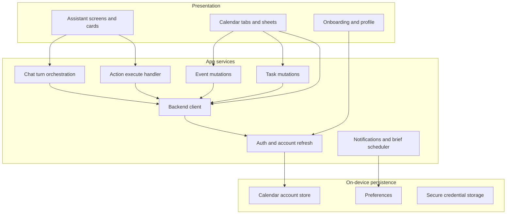

# Architecture

Kalendra's mobile architecture is a Flutter presentation layer over a small set of long-lived services. Screens rarely call HTTP directly; they go through backend, auth, event and task services that encapsulate headers, error shapes and refresh rules. Personal-mode widgets (chat, calendar, onboarding) sit beside shared models and handlers.

## Layered view

## Major components

### Backend client

Centralises HTTPS calls: authentication lifecycle helpers, profile reads, account sync posts, unified calendar queries, per-event CRUD, task CRUD, assistant streaming endpoints and post-confirmation execute. It builds authenticated headers from Firebase ID tokens, user email, display name, optional messaging token, build number, subscription identifier and the connected calendar JSON payload.

Debug versus release builds can target different backend hosts; this repository does not name those hosts.

Streaming methods yield typed maps for each server-sent event so chat code stays declarative.

### Auth and accounts

Wraps Firebase sign-in flows and calendar OAuth. Before network calls it reloads every connected account and refreshes access tokens when expiry is near, returning the updated list the rest of the app consumes.

Sign-out removes a single connected calendar or clears sessions according to profile actions. Concurrent sign-in guards and email verification gates are enforced server-side with corresponding UI sheets.

### Chat orchestration

Maintains in-memory role/content/timestamp history entries, loads usage from profile when opening chat, maps stream events into chat message models with optional card attachments, queues audio playback without blocking text rendering, and raises typed exceptions for turn limits or expired calendar sessions.

Resetting chat clears history locally only.

### Action handler

Validates that proposed actions include a target account email present in the fresh account list, forwards execute calls with the confirmed bit, and translates success or failure into listener callbacks (usage exceeded, session expired, verification required, email-flow initiation).

### Calendar home controller

Owns tab state, month/day anchors, loading flags and the merged event list. Computes conflict sibling lists when opening detail sheets. Routes overlap badge taps to the overlap sheet and month overflow taps to day list sheets. Reloads events and tasks in parallel on entry and after mutations.

### Conflict layout module

Pure grouping helpers plus widgets: badges, tinted overlays, dashed dividers, week/day column layout and overlap sheet UI. Uses shared colour constants for partial orange versus exact red.

### Notifications

Combines local notification scheduling, permission prompts, daily brief copy selection and a background worker entry point to rebuild schedules after reboot or setting changes.

## Data flows

### Read path

User opens calendar tab → auth refreshes tokens → backend unified fetch for window → parse to models → group by day for each tab renderer → user taps event → conflict siblings computed locally → detail sheet.

### Assistant happy path

User sends text → history append → stream request → SSE chunks update UI → response arrives with optional card → if pending action, route to editor or confirm → on confirm, execute call → refresh calendar callbacks.

### Account customisation path

User changes calendar colour locally → account store persists → sync post to backend → other screens may pull profile-backed account rows to reconcile drift.

## Diagrams in this repository

- `assets/diagrams/system-overview.svg` — client, backend and external providers.
- `assets/diagrams/ai-boundary.svg` — device versus network payload categories for one assistant turn.

## Dependencies (conceptual)

Flutter SDK, HTTP client, URL launcher and app links for OAuth, secure storage, shared preferences, audio record/playback plugins, local notifications, background work manager, Firebase suite, in-app purchases, analytics and attribution SDKs, internationalisation and SVG assets.

Native Android and iOS projects host Firebase configuration, OAuth redirect activities and store billing entitlements. Configuration files and signing keys are intentionally absent from this portfolio repo.

## Boundaries and non-goals

The mobile app does not embed provider SDKs for calendar CRUD; those APIs run on the backend with tokens the client supplies. The app does not implement its own language model; it consumes streamed backend output. Calendar data is not modeled as a full offline SQL replica in the client layer described here.
